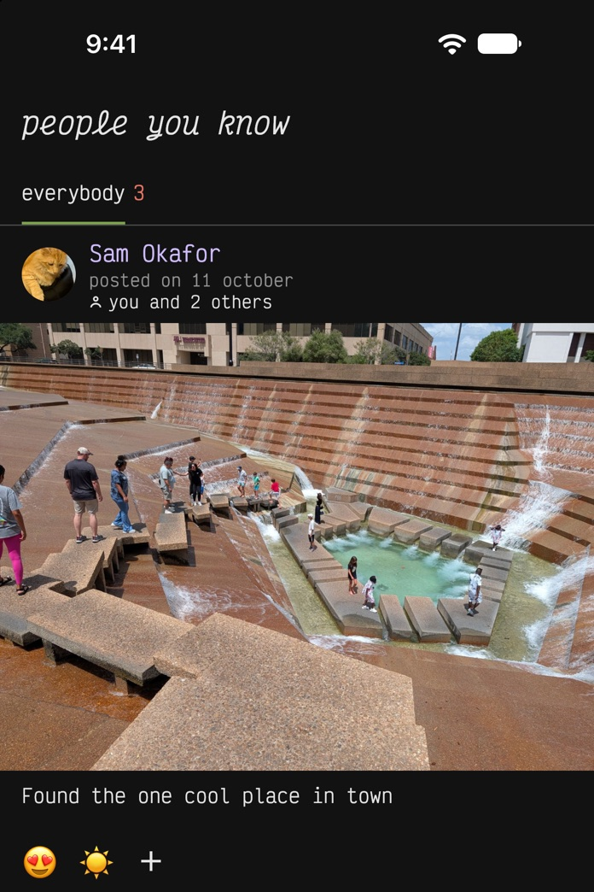
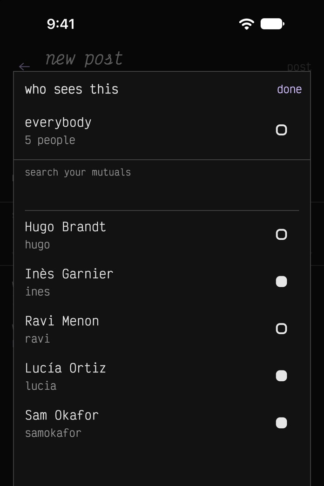
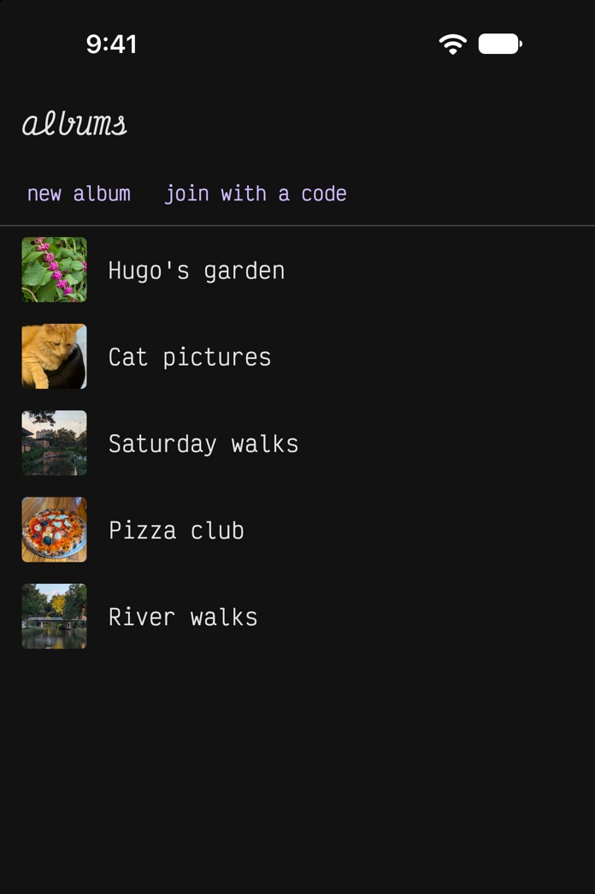

<section class="hero" markdown="1">

# Des photos et de courtes vidéos avec les gens que vous connaissez vraiment, et personne d'autre.

Les réseaux sociaux, c'était pour voir les photos de vos amis et de votre
famille. Puis le fil s'est rempli de publicités, d'influenceurs, d'inconnus
qui se disputent dans les commentaires et de vidéos qui ne finissent jamais.
Les applications financées par la publicité gagnent d'autant plus d'argent que
vous faites défiler longtemps, alors elles sont conçues pour vous retenir :
les publications de vos amis enfouies sous celles qu'on vous suggère, des
notifications pensées pour vous faire revenir, des compteurs d'abonnés et de
vues à faire grimper, et la controverse et la division mises en avant parce
que ce sont elles qui récoltent le plus de commentaires. Et peu à peu, publier
quoi que ce soit de personnel n'a plus semblé sûr.

Voici *people you know*. Rien de ce que vous publiez n'est public, et vous
choisissez qui voit chaque publication.

[Télécharger dans l'App Store](https://apps.apple.com/app/id6812890714)
[Disponible sur Google Play](https://play.google.com/store/apps/details?id=app.pyk.android)
{: .stores}

Proposée aux États-Unis, au Canada, en Nouvelle-Zélande, à Singapour et au
Japon, aux personnes de 18 ans ou plus.
{: .offered}

{: .screens}

</section>

<section class="features-section" markdown="1">

## Ce qui est différent

{: .features}
- **Pas d'abonnés, donc pas d'influenceurs ni de fermes à commentaires.**
  Chaque relation est réciproque&#160;: les deux personnes doivent l'accepter.
  Il n'y a aucun profil public.
- **Vous choisissez qui voit chaque publication.** Toutes vos relations, un
  groupe que vous avez créé ou seulement quelques personnes.
- **Pas d'inconnus dans les commentaires.** Sur la publication d'un ami, vous
  ne voyez que les commentaires des gens que vous connaissez aussi. Dans un
  album partagé, tous les membres voient tous les commentaires.
- **Rien n'est classé ni suggéré.** Votre fil contient les publications qu'on a
  partagées avec vous, des plus récentes aux plus anciennes. Une ligne vous
  indique quand *vous êtes à jour*.
- **Des albums partagés.** Pour les voyages, les mariages, les anniversaires et
  plus encore. Tous les membres d'un album peuvent y ajouter des photos, et
  tous les voient. La personne qui crée un album peut *inviter par courriel*,
  même quelqu'un qui n'utilise pas encore l'application.
- **Chiffrement de bout en bout, avec des clés post-quantiques.** Vos photos,
  vos légendes, vos commentaires et vos noms sont chiffrés sur votre téléphone
  avec des clés que nous ne voyons jamais, conçues pour résister aux
  ordinateurs quantiques, si bien que nous ne pouvons pas les lire. La
  [politique de confidentialité](/fr/politique-de-confidentialite/#ce-que-nous-ne-pouvons-pas-voir)
  indique ce qui est chiffré.
- **Pas de publicité, pas de pistage, et rien sur vous n'est vendu.** Les
  paramètres contiennent *exporter mes données* et *supprimer mon compte*.

[Comment ça marche](/fr/comment-ca-marche/) explique chaque partie de
l'application.
{: .more}

</section>

<section class="get" markdown="1">

## Obtenir l'application

[Télécharger dans l'App Store](https://apps.apple.com/app/id6812890714)
[Disponible sur Google Play](https://play.google.com/store/apps/details?id=app.pyk.android)
{: .stores}

Installez-la et touchez *créer un compte*. Vous vous inscrivez avec votre
adresse de courriel. Vous devez avoir 18 ans ou plus.

L'application est proposée aux États-Unis, au Canada, en Nouvelle-Zélande, à
Singapour et au Japon.

</section>
