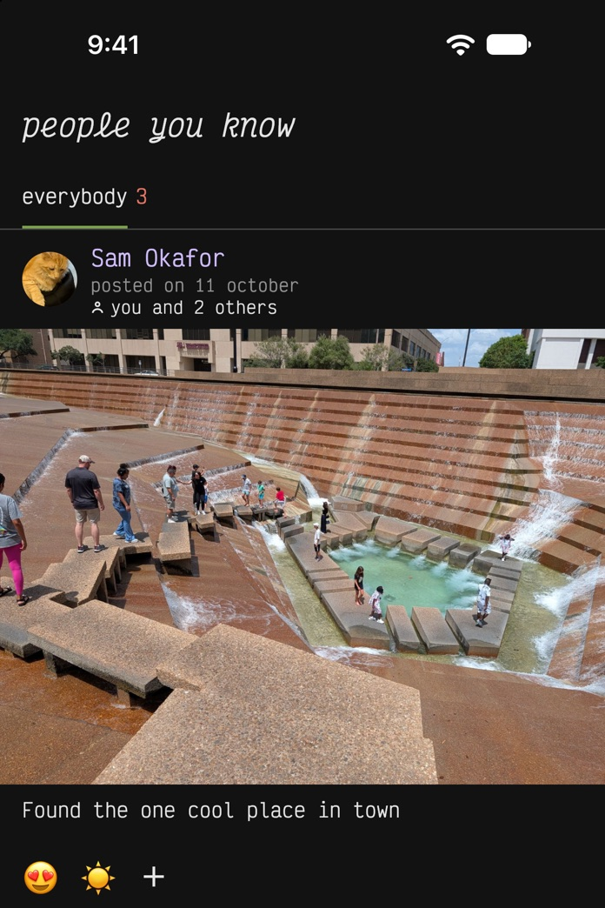
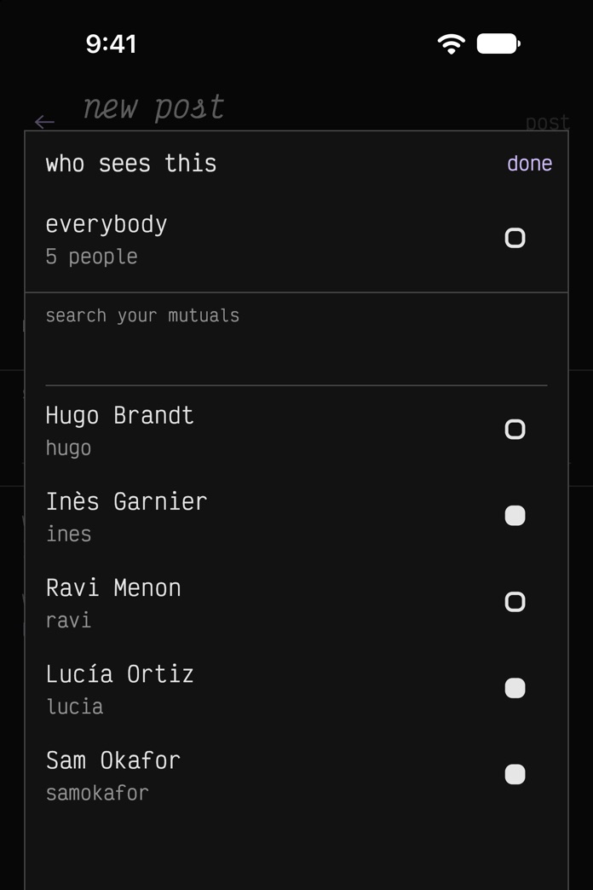
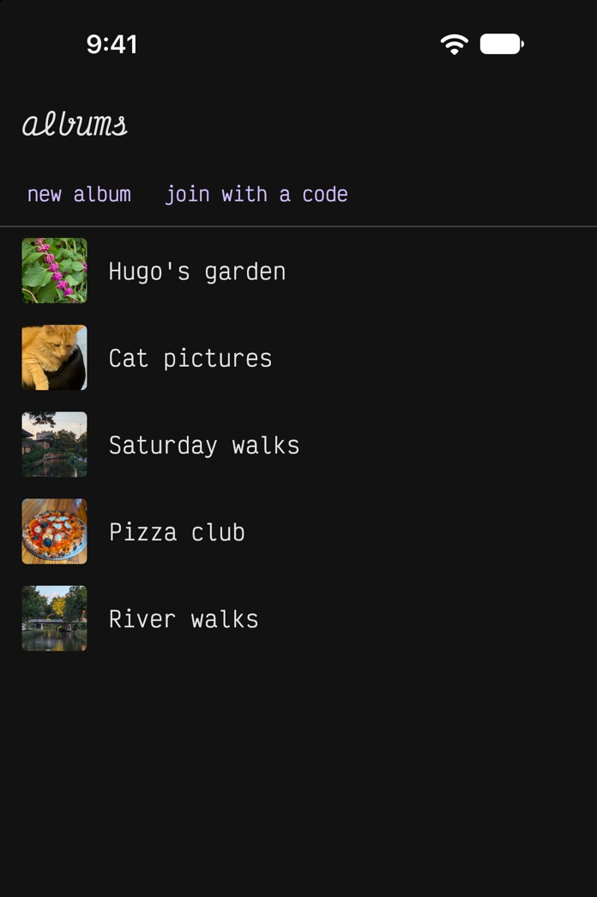

<section class="hero" markdown="1">

# Photos and short videos with the people you actually know, and nobody else.

You joined social media to see your friends' and family's photos. Then the
feed filled up with ads, influencers, strangers arguing in the comments, and
videos that never end. Apps paid for by advertisers earn more the longer you
scroll, so they're built to keep you there: friends' posts buried under
suggested ones, notifications designed to pull you back, follower and view
counts to chase, and controversy and division pushed to the top because they
get the most comments. And somewhere along the way, posting anything personal
stopped feeling safe.

Introducing *people you know*. Nothing you post is public, and you choose who
sees each post.

[Get it on the App Store](https://apps.apple.com/app/id6812890714)
[Get it on Google Play](https://play.google.com/store/apps/details?id=app.pyk.android)
{: .stores}

Offered in the United States, Canada, New Zealand, Singapore and Japan, to
people 18 or older.
{: .offered}

{: .screens}

</section>

<section class="features-section" markdown="1">

## What is different

{: .features}
- **No followers, so no influencers and no comment farms.** Every connection
  is mutual: you both agree to it. There are no public profiles.
- **You choose who sees each post.** Everybody you're connected to, a group
  you made, or just a few people.
- **No strangers in the comments.** On a friend's post, you only see comments
  from people you also know. In a shared album, everybody in it sees every
  comment.
- **Nothing is ranked or suggested.** Your feed is the posts people shared with
  you, newest first. A line tells you when you're *all caught up*.
- **Shared albums.** For trips, weddings, birthdays and more. Everybody in an
  album can add photos, and everybody in it sees them. The person who makes an
  album can *invite by email*, even somebody who isn't on the app yet.
- **End-to-end encryption, with quantum-safe keys.** Your photos, captions,
  comments and names are encrypted on your phone with keys we never see, built
  to hold up against quantum computers, so we can't read them. The
  [privacy policy](privacy/#what-we-cannot-see) lists what is encrypted.
- **No ads, no tracking, and nothing about you is sold.** Settings has
  *export my data* and *delete my account*.

[How it works](how-it-works/) explains each part of the app.
{: .more}

</section>

<section class="get" markdown="1">

## Get the app

[Get it on the App Store](https://apps.apple.com/app/id6812890714)
[Get it on Google Play](https://play.google.com/store/apps/details?id=app.pyk.android)
{: .stores}

Install it and tap *create an account*. You sign up with your email address.
You must be 18 or older.

The app is offered in the United States, Canada, New Zealand, Singapore and
Japan.

</section>
